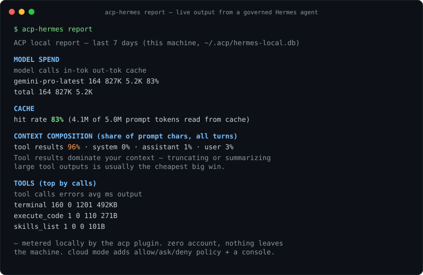

# acp-hermes

**Cost report and allow/ask/deny for [Hermes Agent](https://github.com/NousResearch/hermes-agent)**, via the [Agentic Control Plane](https://agenticcontrolplane.com).

[](https://pypi.org/project/acp-hermes/) [](LICENSE) [](https://pypi.org/project/acp-hermes/)

<p align="center"></p>

Two planes, one plugin:

- **Local metering (no account, nothing leaves your machine):** every model call and tool call your Hermes agent makes is metered into a local SQLite DB. `acp-hermes report` shows spend by model, cache hit rate, what actually fills your context, tool error rates, and cost per task. `report --json` gives agents their own economics so they can self-optimize.
- **Cloud governance (optional, free up to 5 agents; run `acp-hermes login`):** every tool call is checked against server-side policy (deny / ask / allow, with approvals on the console or by email), audited with tenant + session attribution, and visible on a team dashboard across all your machines.

Companion to the [Claude Code ACP plugin](https://github.com/agentic-control-plane/claude-code-acp-plugin). Same backend contract, same dashboard, same policies, wired into Hermes's Python plugin system instead of Claude Code's shell hooks.

Full install guide with dashboard walkthrough: [agenticcontrolplane.com/integrations/hermes](https://agenticcontrolplane.com/integrations/hermes)

## Install

```bash
pip install acp-hermes
hermes plugins enable acp
```

Local metering is now on. After your next Hermes session:

```bash
acp-hermes report
```

```
ACP local report — last 7 days (this machine, ~/.acp/hermes-local.db)

MODEL SPEND
  model                    calls   in-tok  out-tok  cache
  gemini-pro-latest          164     827K     5.2K    83%

CACHE  hit rate 83% (4.1M of 5.0M prompt tokens read from cache)

CONTEXT COMPOSITION (share of prompt chars, all turns)
  tool results 96% · system 0% · assistant 1% · user 3%
  Tool results dominate your context — truncating or summarizing large
  tool outputs is usually the cheapest big win.

TOOLS (top by calls)
  tool             calls  errors  avg ms   output
  terminal           160       0    1201    492KB
```

(That's real output from the autonomous agent that runs our own ops backlog, [governed by the same plugin](https://agenticcontrolplane.com/blog/setup-hermes-autonomous-agent-safely).)

Costs come from Hermes's own pricing engine (same numbers Hermes shows you), including OpenRouter and Bedrock routes. Routes it can't price show as unpriced rather than guessed.

To add policies, approvals, and the cross-machine dashboard:

```bash
acp-hermes login
```

`login` opens the dashboard, exchanges your one-time auth token for a workspace API key, and writes it to `~/.acp/credentials`.

On a headless box (SSH, devcontainer, a server with no browser), use the device flow instead. It prints a short code you approve from any browser, phone included, and the key lands on this machine:

```bash
acp-hermes login --device
```

## Configure

For non-interactive setups (CI, devcontainers), skip the `login` step and provide the key directly:

```bash
export ACP_BEARER_TOKEN="gsk_yourslug_..."
# or
mkdir -p ~/.acp && echo "gsk_yourslug_..." > ~/.acp/credentials
```

The env var wins over the file.

Local metering knobs:

```bash
export ACP_LOCAL_METERING=off      # disable local metering entirely
export ACP_LOCAL_DB=/path/to.db    # move the DB (default ~/.acp/hermes-local.db)
```

## CLI

```bash
acp-hermes report            # local cost & quality X-ray (no account needed)
acp-hermes report --days 30  # wider window
acp-hermes report --json     # machine-readable; feed it back to your agent
acp-hermes login             # browser auth + workspace provisioning (cloud plane)
acp-hermes status            # check creds + gateway reachability
acp-hermes logout            # remove ~/.acp/credentials
```

Optional: point at a non-default backend:

```bash
export ACP_API_BASE="https://api.agenticcontrolplane.com"  # default
```

## How it works

The plugin registers five Hermes hooks:

| Hook               | Plane | Behavior                                                   |
|--------------------|-------|------------------------------------------------------------|
| `pre_tool_call`    | cloud | POSTs to `/govern/tool-use`. Server returns `allow` / `deny` / `ask`. `deny` blocks with a system message; `ask` escalates to Hermes's native approval prompt when a person can answer it, and blocks otherwise (see below); `allow` passes through. |
| `post_tool_call`   | both  | Records duration, status, and result size locally; POSTs to `/govern/tool-output` for server-side audit, redaction logging, and DLP scanning when logged in. When `transform_tool_result` is registered, whichever of the two hooks Hermes runs first for a call sends it, so each call reaches the gateway once. |
| `transform_tool_result` | cloud | Sends the `/govern/tool-output` request (held by `post_tool_call` if that ran first, otherwise built here) and, if the gateway removed personal data, hands Hermes the rewritten result before the model sees it. Hermes runs it after `post_tool_call` on its concurrent path and before it on its sequential registry path; both orders are handled. |
| `post_api_request` | local | Records each LLM API request (model, token buckets: input / output / cache read / cache write / reasoning, and latency) and prices it with Hermes's own pricing engine. |
| `post_llm_call`    | local | Records context composition by role (system / user / assistant / tool results) per turn. |

Local rows land in `~/.acp/hermes-local.db` (SQLite, WAL). Nothing is uploaded from the metering plane.

### Personal data removal

When you are logged in and your workspace removes personal data, tool results are rewritten before the model sees them (Hermes's `transform_tool_result` hook; replaced values read `[REDACTED:<type>]`). What is covered:

- **Covered:** tool results that are text and no larger than 200 KB. The plugin tells the gateway it can apply a rewrite only for these.
- **Not covered:** results over 200 KB (the gateway sees a truncated copy, so nothing is replaced) and results that are not text. These still reach the gateway for audit and detection, but the model sees them unchanged.
- **Rewrites the gateway did not apply:** the plugin replaces a result only when the gateway's reply says the rewrite was applied (`pii.applied: true`). If the gateway's own re-check rejects it, the original is kept and the notice says the model saw it unchanged.
- **Calls that never reach the transform:** blocked, timed-out and cancelled calls, and calls whose dispatch raised, are sent to the gateway straight from `post_tool_call` for audit and are not rewritten.
- **Older Hermes without `transform_tool_result`:** the plugin checks Hermes's list of hook names (`hermes_cli.plugins.VALID_HOOKS`). If the hook is not listed, it is not registered and results are audited as before but never rewritten. If that list cannot be read, the plugin falls back to whether registering the hook raises.
- **At exit:** any audit records still waiting are sent within about 5 seconds in total; the rest are dropped with one warning on stderr.
- **Any failure** (gateway down, timeout, malformed reply): the original result is kept.

A line on stderr says what happened. It says "removed" only when the plugin actually replaced the result; otherwise it says personal data was found and the model saw it unchanged. `ACP_SHADOW=off` silences it with the other notices. Not yet verified against a live Hermes build.

### Fail-open

Network errors, timeouts (>4s), malformed responses, a full disk, or a locked SQLite file all **fail open**: the tool call proceeds and (for network issues) a warning is written to stderr. An unreachable gateway never produces an approval prompt. Hermes has no unattended tier in this plugin, so this holds for every session, background runs included. A call that ran without a policy check is recorded as a lapse and shows as "ran ungoverned" in the console.

### "Ask" semantic

When the gateway holds a call for approval, the plugin shows it through **Hermes's native approval gate**, the same inline `[o]nce / [s]ession / [a]lways / [d]eny` prompt Hermes uses for dangerous shell commands. Hermes labels that prompt "DANGEROUS COMMAND"; the lines under it are the gateway's reason.

The prompt appears only when a person is there to answer it: Hermes runs interactively (`HERMES_INTERACTIVE`) in a terminal (stdin and stdout are both a TTY), the session is not a cron run, a single-query run (`-q`), a messaging-gateway session or a CI job, and no auto-approve mode is on. Each PreToolUse tells the gateway which case applies (`attended: {claim, source: "env", mode}`) and declares `capabilities: ["native_ask"]` only when the prompt can be shown.

In every other case a held call is blocked, with a message that says why Hermes cannot ask and the gateway's reason. Approve it in the ACP console, then run it again. This includes `--yolo` and `/yolo`: Hermes approves every prompt unasked in yolo mode, so the plugin turns a held call into a block instead of letting it run. Approvals switched off (`approvals.mode: off`) and unattended runs (`hermes -z`) are treated the same way. The prompt is shown only with `approvals.mode: manual` (Hermes's default): under `smart`, or any mode the plugin does not know, a held call is blocked. If the plugin cannot read Hermes's yolo or approvals setting, it does not claim a person is there and blocks the held call.

Control characters and bidirectional-override characters in the gateway's reason are removed before Hermes shows it; the text is otherwise unchanged.

If `/yolo` is typed in the moment between the plugin's last check and Hermes's own gate, Hermes approves that call unasked. The plugin checks again right before handing the ask to Hermes, which leaves only that moment.

An `[s]ession` or `[a]lways` answer applies only to the call you were asked about. It does not carry over to later asks, even for the same tool and command: each ask has its own `rule_key`, so the next held call prompts again. Each "always" answer leaves one unused entry in Hermes's `command_allowlist`; it is harmless and can be deleted.

(Versions ≤0.1.0 wrongly claimed Hermes had no approval surface and hard-blocked with a dashboard detour. Upgrade.)

### Client identity

Sends `X-GS-Client: hermes-plugin/<version>` so the dashboard, policy router, and audit log can distinguish Hermes traffic from Claude Code, Cursor, Codex and other harnesses.

## Troubleshooting

**`hermes-acp` opens an editor/ACP mode instead of this CLI.** Hermes itself ships a `hermes-acp` binary (ACP there = Agent Client Protocol, its editor integration). Install order decides which one owns the name. This package installs **`acp-hermes`** as the unambiguous primary command (0.2.1+); use that. `python -m acp_hermes.cli` also always works.

**`acp-hermes report` says no metered activity.** The metering hooks only run inside Hermes. Confirm the plugin is enabled (`hermes plugins list`, then `hermes plugins enable acp`) and run a session. Also check `ACP_LOCAL_METERING` isn't set to `off`.

**Is the plugin actually enabled?** Hermes treats external plugins as opt-in: `pip install` alone makes it *discoverable*, but until `hermes plugins enable acp` runs, **no hooks are registered and sessions send ACP nothing**, silently. `acp-hermes login` runs the enable step for you; `acp-hermes doctor` reads Hermes's own plugin registry and tells you definitively (`hermes plugins list` can mislead: the bundled `copilot-acp-provider` row also contains "acp"). `acp-hermes doctor --canary` then pushes one `acp_doctor` call through Hermes's real pre-dispatch path and reports the verdict.

**A call shows "ran ungoverned" in the console.** That call executed without a pre-call policy check. The row's detail says why: `gateway unreachable at PreToolUse: …` (network/timeout, we fail open) or `pre-hook-missing: …` (Hermes ran the tool without invoking `pre_tool_call` at all). The plugin keeps a per-call ledger and carries these as `pre_lapse` on the next PostToolUse, so the gap is recorded instead of logged as a clean pass.

**Costs show n/a.** Pricing comes from Hermes's engine in-process; routes it can't price (unusual proxies, self-hosted endpoints) show as unpriced. Token counts are still exact.

**No audit events appearing on the dashboard.** Check that `ACP_BEARER_TOKEN` is set in the shell that launched `hermes`, not just your `.zshrc` after the fact. Hermes inherits the env at process start.

**Every tool call blocked.** Look at stderr. A `[ACP] gateway unreachable` warning means network failure (fail-open kicked in, so something else blocked you, maybe a policy from another hook). A `[ACP] Denied by policy: …` means the server returned `deny`; check the policy in the ACP dashboard.

## License

MIT
